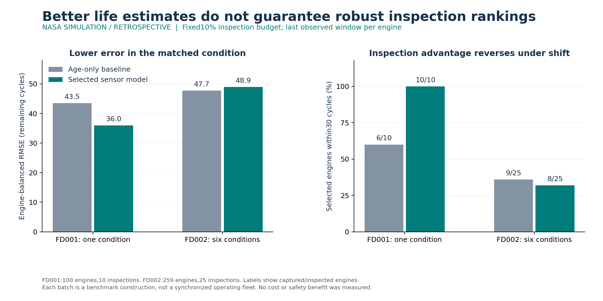
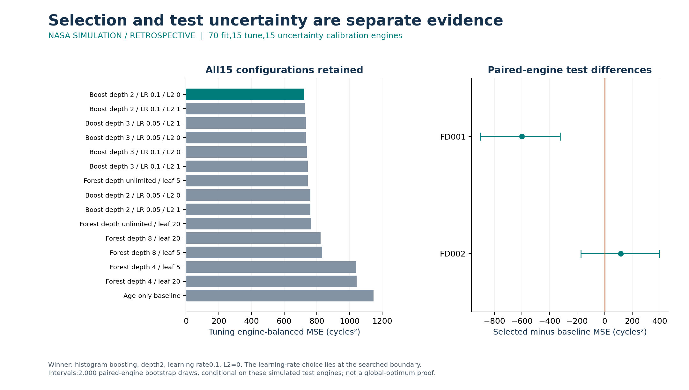
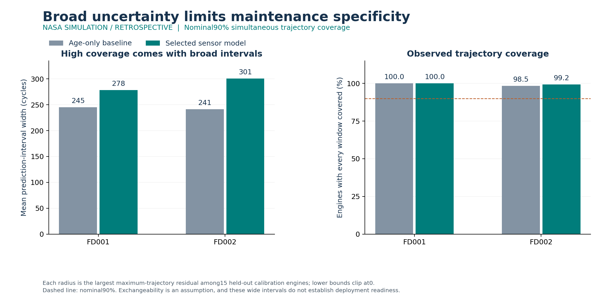

# Remaining-life estimates that earn their inspection budget

**A sensor model improves inspection capture in the matched simulation condition but underperforms the age-only baseline across operating conditions.** This study connects model error to a concrete decision: which engines enter a batch with room to inspect about 10% of them?

**Retrospective numerical correction:** an initial floating-moment implementation disagreed across two Linux workers. Original results and failures are retained in `results/corrections/`. The corrected version preserves source precision with exact integer sensor moments and retains binary feature fingerprints; the grid, split and evaluation tolerance are unchanged. The original test was already inspected, so these corrected results are retrospective.

All source trajectories are **NASA C-MAPSS simulations**. They are not measurements from an operating fleet, and this work makes no deployment, safety or realized savings claim.



| Held-out benchmark | Engine-balanced RMSE, age-only → sensor model | Within 30 cycles among inspected, age-only → sensor model | All near-horizon engines captured by sensor model |
| --- | --- | --- | --- |
| FD001, 100 engines | 43.5 → 36.0 cycles | 6/10 → 10/10 | 10/25, or 40.0% |
| FD002, 259 engines | 47.7 → 48.9 cycles | 9/25 → 8/25 | 8/61, or 13.1% |

The practical next step is operating-condition-aware development on **new, protected evaluation engines**, followed by inspection policies tested against real schedules and defensible costs. The FD002 result does not justify claiming reliable transfer. High uncertainty coverage is also insufficient by itself: the sensor model's mean interval widths are about 278 and 301 cycles on the two tests.

## What was actually optimized

Seventy FD001 training engines fit the models, 15 tune them, and another 15 calibrate uncertainty. No engine contributes to multiple development cohorts. The official FD001 and FD002 tests remain outside fitting, selection and calibration. Source-local IDs are namespaced by partition.

The fixed search contains one age-only baseline, six random forests and eight histogram-boosting configurations. Selection minimizes **mean per-engine MSE**, giving each engine equal weight rather than allowing long trajectories to dominate. The winner is histogram boosting with depth 2, learning rate 0.1, L2 regularization 0 and 100 iterations. Its learning rate lies at the search boundary; this finite comparison does not prove a global optimum. All configurations, runtimes, validation predictions and calibration scores are retained.

Features use current values and past-20-cycle sensor summaries computed from exact source-four-decimal integer moments. Final failure age and remaining life are labels only. The uncertainty radius is the 15th of 15 calibration-engine maximum trajectory residuals, the finite-sample order statistic for nominal 90% trajectory coverage. Exchangeability is an assumption, not an observed performance result or a conditional guarantee.



The paired-engine 95% bootstrap interval for selected-minus-baseline MSE is −901 to −323 cycles² in FD001 and −174 to +396 cycles² in FD002. These intervals are conditional on the benchmark engines. Overlapping windows are never treated as independent resampling units.

## Decision and limitations

Each test engine contributes its last observed window to one benchmark batch. Inspect `floor(0.1 × engine count)` engines with the lowest predicted remaining life, breaking rounded-prediction ties by source-local ID. The main horizon is 30 cycles; the prespecified 15- and 60-cycle comparisons are also exported. A batch is not a synchronized real fleet. An engine outside a chosen horizon is not automatically an economic false positive.



The age-only baseline clips at zero and can produce many tied rankings in the cross-condition cohort; the fixed tie rule is visible in the retained selections. FD001 and FD002 differ in operating-condition structure. The experiment demonstrates dataset stress, not that every individual FD002 regime was unseen. It also tests one fixed split and a small finite model family. No novelty claim is made for the algorithms or calibration method; the contribution is an inspectable comparison of prediction error, broad uncertainty and constrained inspection capture.

## Reproduce and audit

Python 3.10 and pinned dependencies:

```text
pip install -r requirements.txt
python src/retrieve.py
python -m unittest discover -s tests -v
python src/check_reproduction.py
```

The clean replay refits all 15 configurations, recalibrates, evaluates both tests, independently recomputes MSE/MAE, coverage, ranks and paired-engine bootstrap intervals, and checks numerical agreement with the released outputs at `1e-7` absolute / `1e-9` relative tolerance. It writes into a temporary directory and preserves the released results. Retrieval requires the officially linked public source and refuses a changed archive hash.

- [Prespecified protocol](PROTOCOL.md) and [model validation standard](MODEL_VALIDATION_STANDARD.md).
- [Search results](results/search.csv), [frozen selection](results/selection.json), [test results](results/test_summary.json), [independent verification](results/verification_test.json).
- Six contracts test future-input isolation, engine boundaries, label exclusion, equal engine weighting and budget/tie behavior. Independent actual-source feature checks cover six declared windows per partition, not every feature row.
- [Source provenance and publication boundary](SOURCES.md). Raw source files, source paper, manuscript drafts and fitted binary models are excluded from GitHub. Original code and derived evidence are public; no blanket license for NASA source data is asserted.

The private LaTeX manuscript is a research draft, not a submitted or peer-reviewed article. All results describe this benchmark analysis only.
